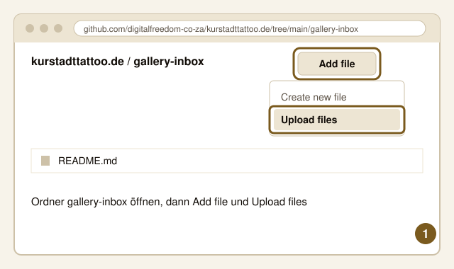
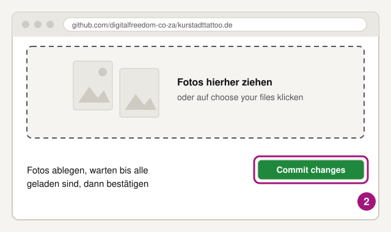
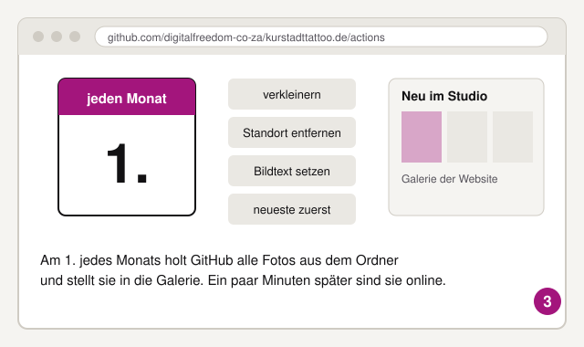
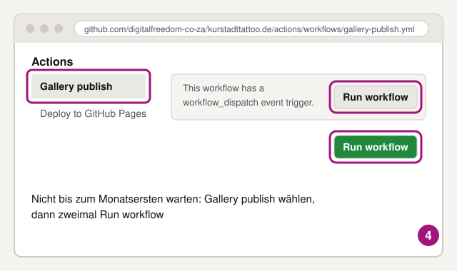
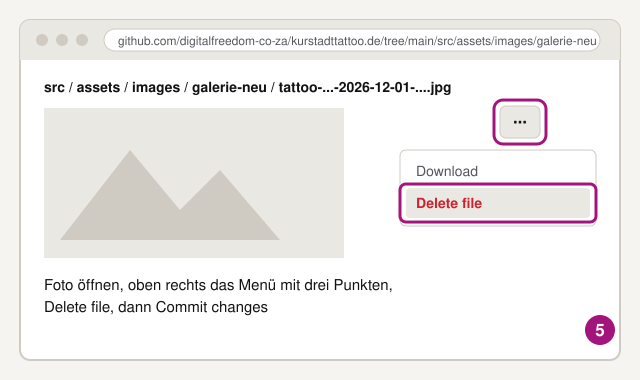

# Neue Fotos in die Galerie stellen

Diese Anleitung zeigt Ihnen, wie neue Tattoo Fotos auf die Website von KurstadtTattoo kommen. Sie brauchen dafür nur einen Browser und Ihr GitHub Konto. Am einfachsten geht es am Computer.

Kurz gesagt: Sie legen die Fotos in einen Ordner. Am 1. jedes Monats stellt GitHub sie von selbst in die Galerie.

## 1. Was für Fotos?

- Nur fertige Tattoos aus dem Studio.
- Nur Fotos, bei denen der Kunde einverstanden ist, dass sein Tattoo auf der Website gezeigt wird.
- Kein Gesicht und kein lesbarer Name oder Datum, außer der Kunde ist damit einverstanden.
- Bei Logos, Vereinswappen, Comicfiguren oder bekannten Personen im Motiv fragen Sie bitte vorher Marcello.
- Scharf und hell, das Tattoo gut zu sehen.
- Dateiart JPG (PNG oder WebP gehen auch). Fotos im Format HEIC werden nicht verarbeitet.
- Mindestens 1200 Pixel an der langen Seite, höchstens 25 MB. Normale Handyfotos passen.

Zwei Einstellungen am iPhone helfen:

- Damit das iPhone JPG Fotos macht: Einstellungen, Kamera, Formate, Maximale Kompatibilität.
- Damit im Foto nicht steht, wo es aufgenommen wurde: Einstellungen, Datenschutz und Sicherheit, Ortungsdienste, Kamera, Nie.

Warum der Standort wichtig ist: Der Ordner ist öffentlich. Das Originalfoto bleibt dort im Verlauf sichtbar, mit allem, was das Handy darin speichert. Auf der Website selbst sind diese Angaben immer entfernt.

## 2. Fotos hochladen

1. Öffnen Sie den Ordner gallery-inbox: https://github.com/digitalfreedom-co-za/kurstadttattoo.de/tree/main/gallery-inbox
2. Klicken Sie oben rechts auf Add file und dann auf Upload files.

3. Ziehen Sie die Fotos in das große Feld. Oder klicken Sie auf choose your files und wählen Sie die Fotos aus.
4. Warten Sie, bis alle Fotos geladen sind.
5. Klicken Sie unten auf den grünen Knopf Commit changes. Fertig.

### Bildtext dazu (freiwillig)

Ohne eigenen Text steht unter dem Foto Tattoo aus dem Studio. Wenn Sie einen eigenen Text möchten:

1. Im Ordner gallery-inbox auf Add file und dann auf Create new file klicken.
2. Als Namen den Namen des Fotos nehmen, aber mit .txt am Ende. Zum Foto IMG_1234.jpg gehört IMG_1234.txt.
3. In die erste Zeile den deutschen Text schreiben, zum Beispiel: Rose mit Schriftzug, Unterarm
4. Wenn Sie möchten, in die zweite Zeile den englischen Text mit EN: davor, zum Beispiel: EN: Rose with lettering, forearm
5. Unten auf Commit changes klicken.

Ohne englischen Text steht auf der englischen Seite Tattoo from the studio.

## 3. Was jeden Monat passiert

Am 1. jedes Monats, morgens, holt GitHub alle Fotos aus dem Ordner gallery-inbox und

- macht sie kleiner, damit die Seite schnell lädt,
- entfernt alle versteckten Angaben im Foto, zum Beispiel den Standort,
- setzt den Bildtext, wenn es einen gibt,
- stellt sie in der Galerie ganz oben unter Neu im Studio ein, die neuesten zuerst.

Danach ist der Ordner wieder leer. Ein paar Minuten später sind die Fotos auf der Website.

Liegt ein Foto danach noch im Ordner, konnte es nicht verwendet werden, meistens weil es ein HEIC Foto oder zu klein ist. Löschen Sie es dann und laden Sie es als JPG neu hoch.

Ein Foto, das schon in der Galerie ist, wird nicht doppelt eingestellt.

## 4. Sofort veröffentlichen

Sie möchten nicht bis zum Monatsersten warten?

1. Öffnen Sie: https://github.com/digitalfreedom-co-za/kurstadttattoo.de/actions/workflows/gallery-publish.yml
2. Klicken Sie rechts auf Run workflow.
3. Klicken Sie im kleinen Fenster noch einmal auf den grünen Knopf Run workflow.

Nach etwa zehn Minuten sind die Fotos auf der Website.

## 5. Ein Foto wieder entfernen

1. Öffnen Sie den Ordner mit den veröffentlichten Fotos: https://github.com/digitalfreedom-co-za/kurstadttattoo.de/tree/main/src/assets/images/galerie-neu
2. Klicken Sie auf das Foto, das weg soll. Im Namen steht das Datum, an dem es eingestellt wurde.
3. Klicken Sie oben rechts auf das Menü mit den drei Punkten und dann auf Delete file.
4. Klicken Sie auf Commit changes.

Ein paar Minuten später ist das Foto nicht mehr auf der Website.

Ein Foto, das noch im Ordner gallery-inbox liegt, löschen Sie dort genauso.

## 6. Wen fragen?

Bei Fragen, oder wenn ein Foto nicht erscheint: Marcello (Marcel R. G. Berger). Bitte ändern Sie nichts in anderen Ordnern.
