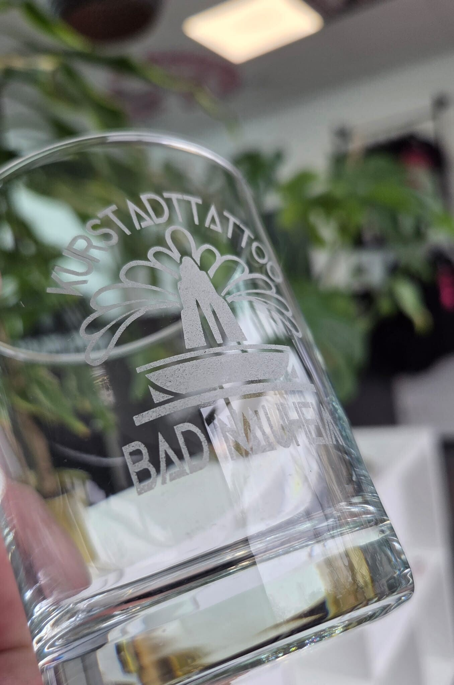
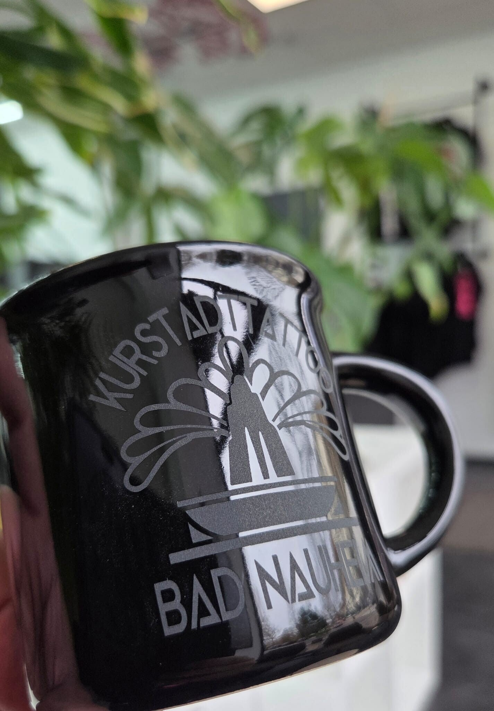
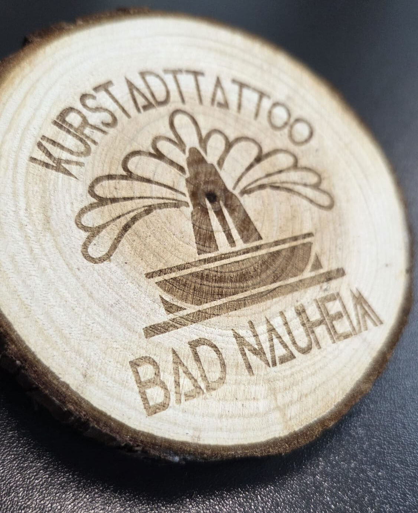

# Quelle: https://www.kurstadttattoo.de/gravur-service

- Abgerufen: 2026-11-12 (curl, Original-HTML unter `html/`)
- Title: Lasergravur Bad Nauheim | Individuelle Gravuren
- Meta description: Professionelle Lasergravuren in Bad Nauheim: Individuelle Gravuren auf Edelstahl, Holz, Glas, Aluminium und Kunststoff. Jetzt Gravur anfragen!
- og:image:
  - gravur-glas-logo.jpg
  - gravur-tasse-schwarz-logo.jpg
  - gravur-holzscheibe-logo.jpg
- Header-Bannerbild (Kopfbereich ueber dem Inhalt): nicht-verwenden-stock-unsplash-taetowieren-nahaufnahme.jpg

Rohtext des Bereichs `<main>`, nur Struktur bereinigt, Wortlaut unverändert.

---

Willkommen auf der Gravur Service Seite von KurstadtTattoo Bad Nauheim. Erfahren Sie mehr über unsere Lasergravuren für Kunststoff, Stahl, Edelstahl, Leder und Aluminium.

# Gravuren aller Art

Individuelle Gravuren auf Ihrem Geschenk? Kein Problem! Wir arbeiten mit der neuster Lasertechnik. Auch Logos oder Grafiken sind kein Problem!

Gravur auf Kunststoff

- für den Außen- und Inneneinsatz geeignet

- Verwendung für Namensschilder, Tür- und Klingelschilder, Kugelschreiber Hinweisschilder oder Pokalschilder

- Größen frei wählbar (max. Gravurgröße: 400 x 115 mm)

Gravur auf Aluminium z.B. Visitenkarten

- Besonders hochwertig

- sehr langlebig und witterungsbeständig

- individuelle Typenschilder nach Ihren Vorgaben

Gravur auf Messing und Edelstahl

- Geeignet für den Innen- und Außeneinsatz

- Edles Design

- auch Logos und Grafiken

Gravur auf Holz

- Gravur auf Ihr Brotzeitbrettl den Kochlöffel oder Ihr individuelles Geschenk? Mit unserer Lasergravur kein Problem!

Gravur auf Glas

- Egal ob Weizenglas, Halbekrug oder Sektglas für Ihren Hochzeitsempfang

