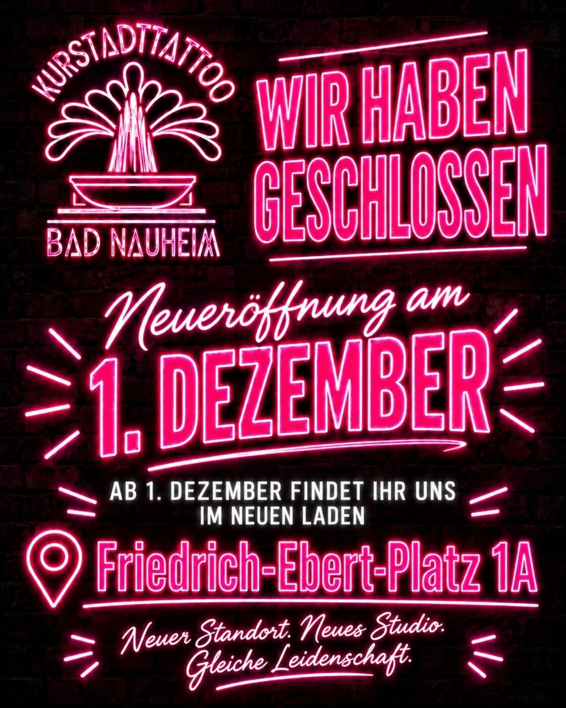
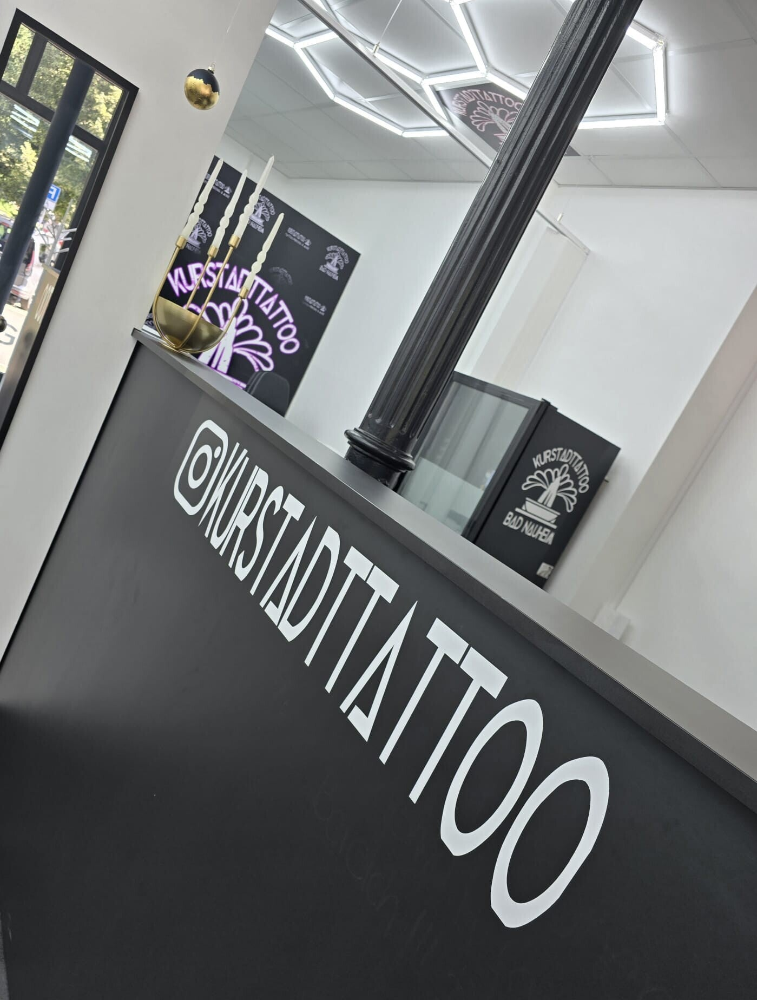
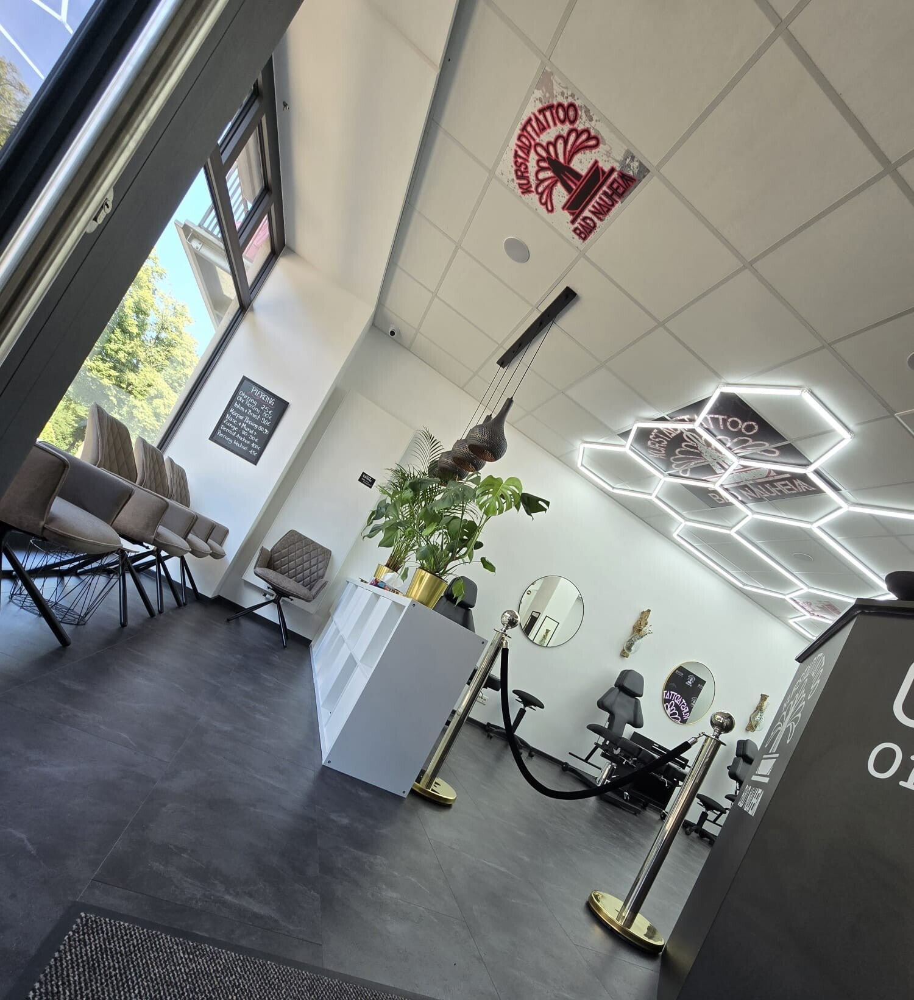
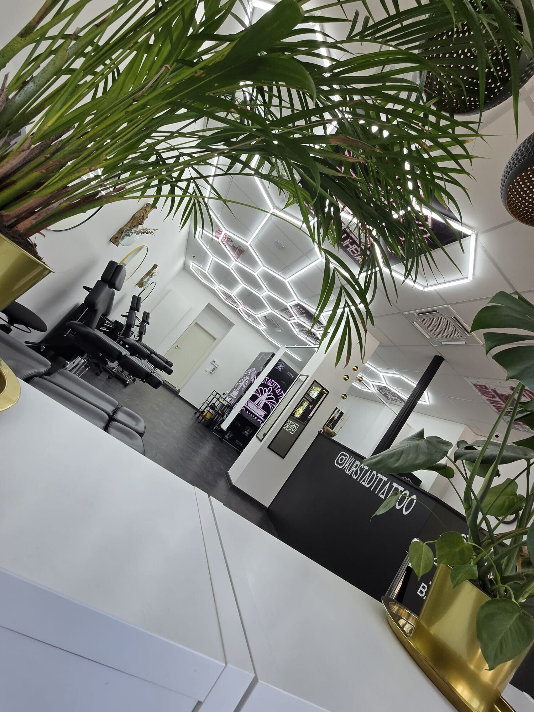
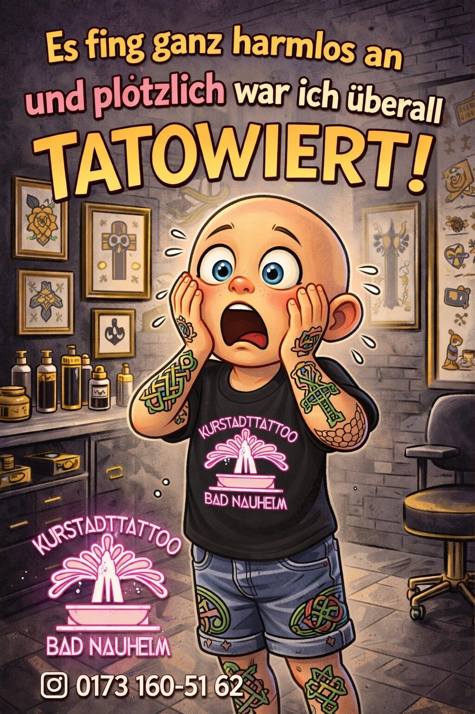
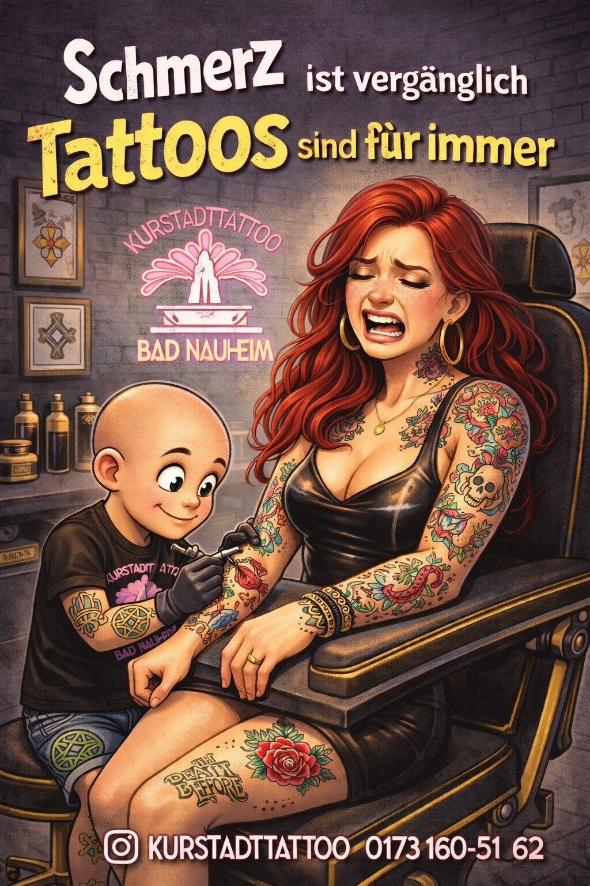

# Quelle: https://www.kurstadttattoo.de/

- Abgerufen: 2026-11-12 (curl, Original-HTML unter `html/`)
- Title: Tattoo Studio Bad Nauheim | KurstadtTattoo
- Meta description: KurstadtTattoo – dein Tattoo Studio in Bad Nauheim. Individuelle Tattoos, Fine Line, Realistic Tattoos und Piercings. Jetzt Beratung und Termin anfragen!
- og:image:
  - aushang-geschlossen-neueroeffnung-1-dezember.jpg
  - studio-empfangstheke-schriftzug.jpg
  - studio-empfang-sitzbereich.jpg
  - studio-pflanzen-wabenlicht.jpg
  - nicht-verwenden-ki-illustration-taetowiert.jpg
  - nicht-verwenden-ki-illustration-schmerz-vergaenglich.jpg
- Header-Bannerbild (Kopfbereich ueber dem Inhalt): (keins)

Rohtext des Bereichs `<main>`, nur Struktur bereinigt, Wortlaut unverändert.

---

# Willkommen bei KurstadtTattoo Bad Nauheim

Bei KurstadtTattoo Bad Nauheim bieten wir dir hochwertige Tattoos und Piercings. Unser Studio in Bad Nauheim in Hessen kurz vor den Toren von Frankfurt, ist der ideale Ort, um deine Körperkunstträume wahr werden zu lassen.

### Unsere Öffnungszeiten:

### Montag - Freitag 12-18 Uhr

### oder nach Vereinbarung

[YouTube-Video: Herzlich Willkommen bei Kurstadttattoo](https://www.youtube.com/watch?v=3XznCCfiK7s)

## Folge uns auf TikTok

### [Patrick KurstadtTattoo (@patrickkurstadttattoo) | TikTok](https://www.tiktok.com/@patrickkurstadttattoo)

## Häufig gestellte Fragen

### Wie pflege ich mein neues Tattoo?

Um dein neues Tattoo zu pflegen, solltest du es regelmäßig reinigen und eine spezielle Tattoo-Pflegecreme auftragen. Vermeide direkte Sonneneinstrahlung und Kratzen.

### Wie lange dauert die Heilung eines Piercings?

Die Heilung eines Piercings kann je nach Stelle zwischen wenigen Wochen und mehreren Monaten dauern. Es ist wichtig, das Piercing regelmäßig zu reinigen und auf Anzeichen einer Infektion zu achten.

### Wie funktioniert die Tattoo-Entfernung?

Die Tattoo-Entfernung erfolgt durch Laserbehandlungen, die das Tattoo nach und nach verblassen lassen. Mehrere Sitzungen sind erforderlich, um das gewünschte Ergebnis zu erzielen. Diese Behandlung bieten mehrere Hautärzte an. Infos könnt ihr von uns bekommen.

[YouTube-Video: Fuchstattoo realistic #badnauheim #tattooartist #tattooed #tattooart #tattooideas #tattoo #friedberg](https://www.youtube.com/watch?v=oioWU94jZ1E)

## Kontaktiere uns

Für Terminanfragen oder weitere Informationen kontaktieren Sie uns bitte über das Formular.

Name *

E-Mail-Adresse *

Nachricht *

Dieses Feld leer lassen

## Standort

KurstadtTattoo Bad Nauheim
Parkstr. 22

61231 Bad Nauheim

Deutschland

## Über uns

KurstadtTattoo ist dein verlässlicher Partner für Tattoos und Piercings in Bad Nauheim, Deutschland. Seit unserer Gründung legen wir großen Wert auf Qualität, Hygiene und Kundenzufriedenheit. Unser erfahrenes Team von Tätowierern und Piercern steht dir mit Rat und Tat zur Seite, um deine individuellen Wünsche und Vorstellungen zu verwirklichen. Unsere modernen und gut ausgestatteten Räumlichkeiten bieten dir eine angenehme und sichere Atmosphäre. Egal, ob du nach einem neuen Tattoo oder einem Piercing suchst, bei uns bist du in den besten Händen. Wir freuen uns darauf, dich bei uns begrüßen zu dürfen und gemeinsam mit dir dein nächstes Körperkunstprojekt zu planen.

Tattoo Studio Wetterau
