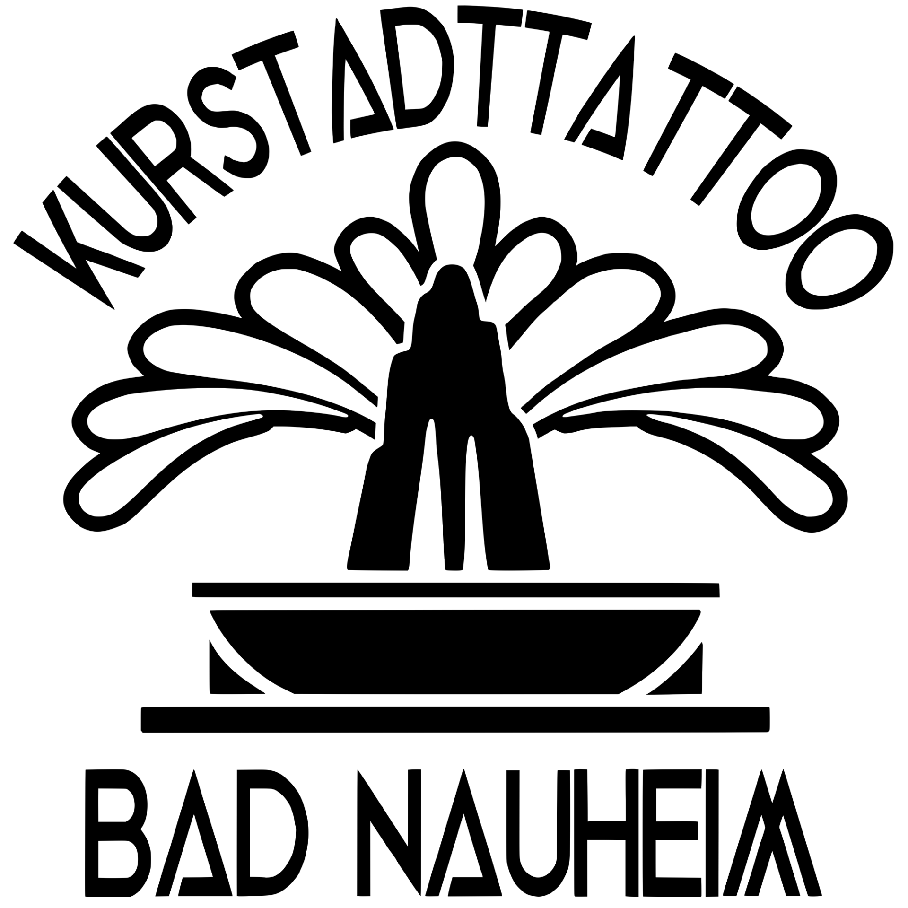

# Quelle: https://www.kurstadttattoo.de/kontakt-und-impressum

- Abgerufen: 2026-11-12 (curl, Original-HTML unter `html/`)
- Title: Tattoo Termin Bad Nauheim | Kontakt & Anfahrt
- Meta description: Kontaktiere KurstadtTattoo in Bad Nauheim für Tattoo-Termine, Piercing-Anfragen und persönliche Beratung. Hier findest du Kontakt und Standort.
- og:image:
  - logo-kurstadttattoo-schwarz.png
- Header-Bannerbild (Kopfbereich ueber dem Inhalt): (keins)

Rohtext des Bereichs `<main>`, nur Struktur bereinigt, Wortlaut unverändert.

---

## Kontaktiere uns

Für Terminanfragen rufe Sie uns bitte an. Bei weiteren Informationen kontaktieren Sie uns bitte über das Formular.

Name *

E-Mail-Adresse *

Nachricht *

Dieses Feld leer lassen

## Standort

KurstadtTattoo Bad Nauheim
Parkstr. 22

61231 Bad Nauheim

Deutschland

0173 160 51 62

[Facebook](https://facebook.com/profile.php?id=61562038843611) [Instagram](https://instagram.com/kurstadttattoo/) [TikTok](https://tiktok.com/@kurstadttattoo)

Impressum
ANGABEN GEMÄSS § 5 TMG
RuW Lifestyle GmbH
Beneke Str. 9
61231 Bad Nauheim

KONTAKT
Telefon: +49 1731605162
E-Mail: [Kurstadttattoo@web.de](mailto:Kurstadttattoo@web.de)

Geschäftsführer: Patrick Wolf

UMSATZSTEUER-ID gemäß § 27 a Umsatzsteuergesetz.

DE323734171
Steuernummer:
020 24293213

BERUFSBEZEICHNUNG UND BERUFSRECHTLICHE REGELUNGEN
Berufsbezeichnung: Tätowierer und Piercer

EU-STREITSCHLICHTUNG
Die Europäische Kommission stellt eine Plattform zur Online-Streitbeilegung (OS) bereit: https://ec.europa.eu/consumers/odr.
Unsere E-Mail-Adresse finden Sie oben im Impressum.

VERBRAUCHER STREIT BEILEGUNG/UNIVERSAL SCHLICHTUNGS STELLE
Wir sind nicht bereit oder verpflichtet, an Streitbeilegungsverfahren vor einer Verbraucherschlichtungsstelle teilzunehmen.

DESIGN & UMSETZUNG
Diese Website wurde von Fuckyou4ze Mediadesign umgesetzt.

HAFTUNG FÜR INHALTE
Als Diensteanbieter sind wir gemäß § 7 Abs.1 TMG für eigene Inhalte auf diesen Seiten nach den allgemeinen Gesetzen verantwortlich. Nach §§ 8 bis 10 TMG sind wir als Diensteanbieter jedoch nicht verpflichtet, übermittelte oder gespeicherte fremde Informationen zu überwachen oder nach Umständen zu forschen, die auf eine rechtswidrige Tätigkeit hinweisen.
Verpflichtungen zur Entfernung oder Sperrung der Nutzung von Informationen nach den allgemeinen Gesetzen bleiben hiervon unberührt. Eine diesbezügliche Haftung ist jedoch erst ab dem Zeitpunkt der Kenntnis einer konkreten Rechtsverletzung möglich. Bei Bekanntwerden von entsprechenden Rechtsverletzungen werden wir diese Inhalte umgehend entfernen.

HAFTUNG FÜR LINKS
Unser Angebot enthält Links zu externen Websites Dritter, auf deren Inhalte wir keinen Einfluss haben. Deshalb können wir für diese fremden Inhalte auch keine Gewähr übernehmen. Für die Inhalte der verlinkten Seiten ist stets der jeweilige Anbieter oder Betreiber der Seiten verantwortlich. Die verlinkten Seiten wurden zum Zeitpunkt der Verlinkung auf mögliche Rechtsverstöße überprüft. Rechtswidrige Inhalte waren zum Zeitpunkt der Verlinkung nicht erkennbar.
Eine permanente inhaltliche Kontrolle der verlinkten Seiten ist jedoch ohne konkrete Anhaltspunkte einer Rechtsverletzung nicht zumutbar. Bei Bekanntwerden von Rechtsverletzungen werden wir derartige Links umgehend entfernen.

URHEBERRECHT
Die durch die Seitenbetreiber erstellten Inhalte und Werke auf diesen Seiten unterliegen dem deutschen Urheberrecht. Die Vervielfältigung, Bearbeitung, Verbreitung und jede Art der Verwertung außerhalb der Grenzen des Urheberrechtes bedürfen der schriftlichen Zustimmung des jeweiligen Autors bzw. Erstellers. Downloads und Kopien dieser Seite sind nur für den privaten, nicht kommerziellen Gebrauch gestattet.
Soweit die Inhalte auf dieser Seite nicht vom Betreiber erstellt wurden, werden die Urheberrechte Dritter beachtet. Insbesondere werden Inhalte Dritter als solche gekennzeichnet. Sollten Sie trotzdem auf eine Urheberrechtsverletzung aufmerksam werden, bitten wir um einen entsprechenden Hinweis. Bei Bekanntwerden von Rechtsverletzungen werden wir derartige Inhalte umgehend entfernen.
