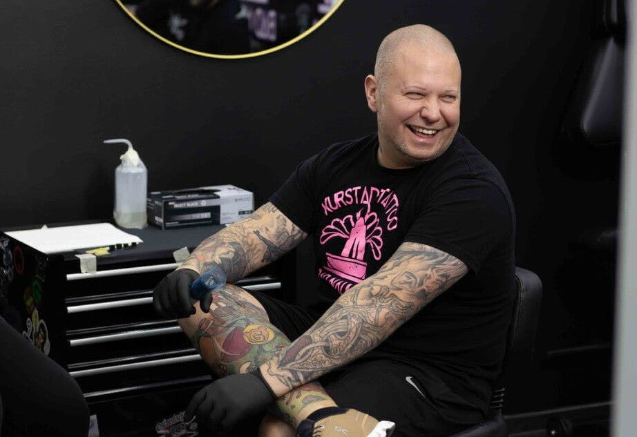
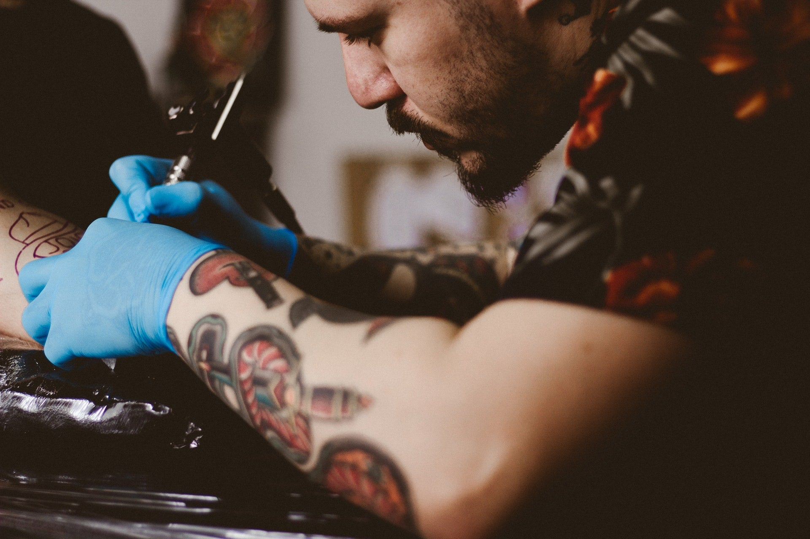

# Quelle: https://www.kurstadttattoo.de/pflegetipps

- Abgerufen: 2026-11-12 (curl, Original-HTML unter `html/`)
- Title: Tattoo-Pflege & Heilung | Tipps zur Nachsorge
- Meta description: Wie pflegt man ein frisches Tattoo richtig? Erfahre alles zur Tattoo-Heilung, Nachsorge und Piercing-Pflege. Tipps von KurstadtTattoo Bad Nauheim.
- og:image:
  - (keins)
- Header-Bannerbild (Kopfbereich ueber dem Inhalt): (keins)

Rohtext des Bereichs `<main>`, nur Struktur bereinigt, Wortlaut unverändert.

---

# Pflegetipps für Ihr neues Tattoo und Piercing

Erfahren Sie, wie Sie Ihr neues Tattoo oder Piercing optimal pflegen können.

[YouTube-Video: Wie pflegt man ein #Tattoo](https://www.youtube.com/watch?v=-bt8M9ESxDc)

# Allgemeine Pflegehinweise

Nachdem Sie ein neues Tattoo oder Piercing erhalten haben, ist die richtige Pflege entscheidend für den Heilungsprozess und die langfristige Qualität. Waschen Sie Ihre Hände gründlich, bevor Sie Ihr Tattoo oder Piercing berühren. Bei einem Tattoo sollten Sie die Folie nach den ersten Stunden entfernen und die Stelle vorsichtig mit lauwarmem Wasser und einer milden Seife reinigen. Tupfen Sie die Stelle trocken und tragen Sie eine dünne Schicht einer empfohlenen Heilsalbe auf. Bei einem Piercing ist es wichtig, die Stelle regelmäßig mit einer Kochsalzlösung zu reinigen und unnötigen Kontakt zu vermeiden.

# Vermeiden Sie Komplikationen

Während der Heilungsphase sollten Sie direkten Sonnenkontakt, Solarium und Schwimmen in Pools oder Seen vermeiden, da diese Faktoren die Wundheilung beeinträchtigen können. Tragen Sie lockere Kleidung, die nicht an Ihrem Tattoo oder Piercing reibt, um Irritationen zu verhindern. Beim Schlafen achten Sie darauf, nicht auf der frisch tätowierten oder gepiercten Stelle zu liegen. Sollten Sie Anzeichen von Infektionen wie starke Rötungen, Schwellungen oder eitrige Absonderungen bemerken, suchen Sie bitte umgehend einen Arzt auf.

# Langzeitpflege und Erhaltung

Auch nach der vollständigen Heilung sollten Sie Ihr Tattoo und Piercing regelmäßig pflegen, um die Farben und das Aussehen zu erhalten. Verwenden Sie weiterhin Feuchtigkeitscremes ohne Duftstoffe und schützen Sie Ihr Tattoo vor intensiver Sonneneinstrahlung mit einem hohen Lichtschutzfaktor. Piercings sollten gelegentlich herausgenommen und der Schmuck sowie die Stelle gereinigt werden. Bei Fragen oder Problemen stehen wir Ihnen jederzeit zur Verfügung und bieten Ihnen gerne eine Nachsorge an.

## Kontaktieren Sie uns

Haben Sie noch Fragen zur Pflege Ihres neuen Tattoos oder Piercings? Wir sind für Sie da!

[Jetzt Kontakt aufnehmen](/kontakt)
