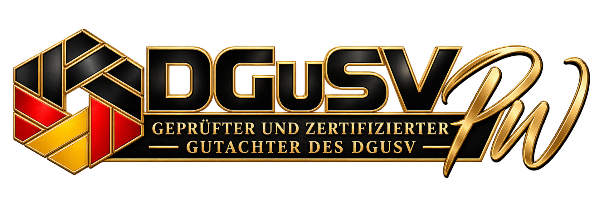
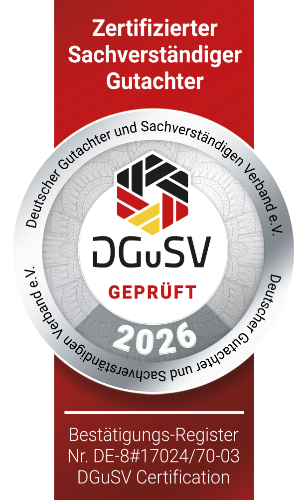
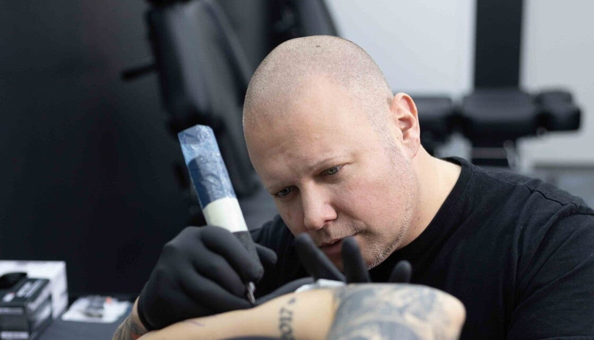
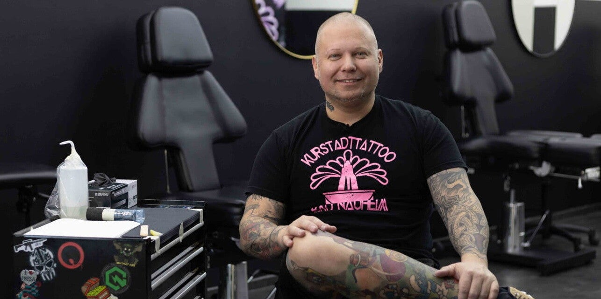

# Quelle: https://www.kurstadttattoo.de/sachverstaendigen-und-gutachten

- Abgerufen: 2026-11-12 (curl, Original-HTML unter `html/`)
- Title: Tattoo-Gutachter & Sachverständiger | Patrick Wolf
- Meta description: Schlecht gestochenes Tattoo? Patrick Wolf ist geprüfter und zertifizierter DGUSV-Gutachter mit über 22 Jahren Erfahrung. Tattoo-Gutachten deutschlandweit.
- og:image:
  - dgusv-gutachteremblem-monogramm.png
  - siegel-dgusv-2026.png
- Header-Bannerbild (Kopfbereich ueber dem Inhalt): studio-lampen-neonlogo-breit.jpg

Rohtext des Bereichs `<main>`, nur Struktur bereinigt, Wortlaut unverändert.

---

[Link](https://www.tattoogutachten.de/)

[www.tattoogutachten.de](https://www.tattoogutachten.de/)

# Sachverständigen und Gutachten

Erfahren Sie mehr über unsere Sachverständigen und Gutachten für Tattoos und Piercings. Mit 22 Jahren Erfahrung in der Branche ist Patrick Wolf Ihr Experte für professionelle Gutachten in der Wetterau und Hessen

[Link](https://tattoogutachten.dgusv.de/)

## Als geprüfter und zertifizierter Gutachter des DGuSV

ist Patrick einer von nur vier anerkannten Tattoo-Gutachtern in Deutschland. Mit über 22 Jahren Berufserfahrung im Tattoo- und Piercinghandwerk vereint er Fachwissen, Präzision und Leidenschaft.
Als Mitglied im Bundesverband Tattoo engagiert er sich zudem aktiv für Qualitätsstandards, Verbraucherschutz und die fachliche Weiterentwicklung der Branche.
Seine Expertise macht ihn zu einem verlässlichen Ansprechpartner für alle Fragen rund um Tattoos, Piercings, Cover-Ups und Tattoo-Entfernung .

Tätigkeitsfelder

-

Tattoo- & Piercing-Gutachten (gerichtsfest)

-

Schadenersatz und Rechtsberatung

-

Mediation und Schiedsverfahren

-

Tattoo-Design und Fachberatung

-

Weitervermittlung an spezialisierte Tattoo-Entfernungsexperten

Unser Service umfasst nicht nur die Erstellung von Gutachten , sondern auch fachkundige Beratung in allen Belangen des Tattoo- und Piercingwesens.
Egal, ob Sie sich für ein neues Tattoo interessieren, ein bestehendes überprüfen lassen möchten oder eine Entfernung in Betracht ziehen – bei uns sind Sie in kompetenten und vertrauenswürdigen Händen .

### Wenn etwas schiefgelaufen ist …

Leider gibt es immer wieder Kundinnen und Kunden, die unzufrieden oder enttäuscht über das Ergebnis ihres Tattoos sind – sich jedoch nicht trauen, ihre Reklamation vorzubringen oder rechtliche Schritte einzuleiten.
Gleichzeitig stehen auch Tattoo-Studios manchmal zu Unrecht im Fokus einer Klage , obwohl sie professionell gearbeitet haben.

In beiden Fällen hilft ein neutral erstelltes Sachverständigengutachten :
Mit überschaubarem Aufwand kann geklärt werden, ob eine Forderung berechtigt ist oder nicht .
Einfach telefonisch oder per E-Mail einen Termin vereinbaren – und los geht’s!
Das Erstberatungsgespräch ist kostenlos .

[YouTube-Video: Tattoopfusch Anwalt und dann Gericht](https://www.youtube.com/watch?v=xYoJRpQzUro)

[YouTube-Video: Verpfuschtes Tattoo und Geld zurück?](https://www.youtube.com/watch?v=zAxaQblIOk4)

# Warum ich der Richtige bin

Seriös. Kompetent. Professionell.
Ich stehe für Unvoreingenommenheit, Ehrlichkeit und Neutralität – und nehme kein Blatt vor den Mund.
Leere Versprechungen oder Schönrederei haben bei mir keinen Platz.

Fehler in Tattoos zu erkennen, ihre Ursachen zu analysieren und mögliche Lösungen aufzuzeigen, ist meine Stärke – und meine Leidenschaft.
Dank meiner Erfahrung als Laserspezialist für Tattooentfernung (bis 2021) kann ich dir fundiert helfen, dein Tattoo zu korrigieren oder zu retten , damit du dich wieder wohlfühlst.

Vertraue auf über zwei Jahrzehnte Erfahrung, Fachwissen und Leidenschaft.
Wenn es um Tattoo-Gutachten, Cover-ups, Korrekturen oder Piercingfragen geht, bist du bei mir genau richtig.

## Kontaktiere uns noch heute!

Wenn Sie professionelle Gutachten für Tattoos und Piercings benötigen, zögern Sie nicht, uns zu kontaktieren. Unser Experte steht Ihnen gerne zur Verfügung.

Jetzt kontaktieren
