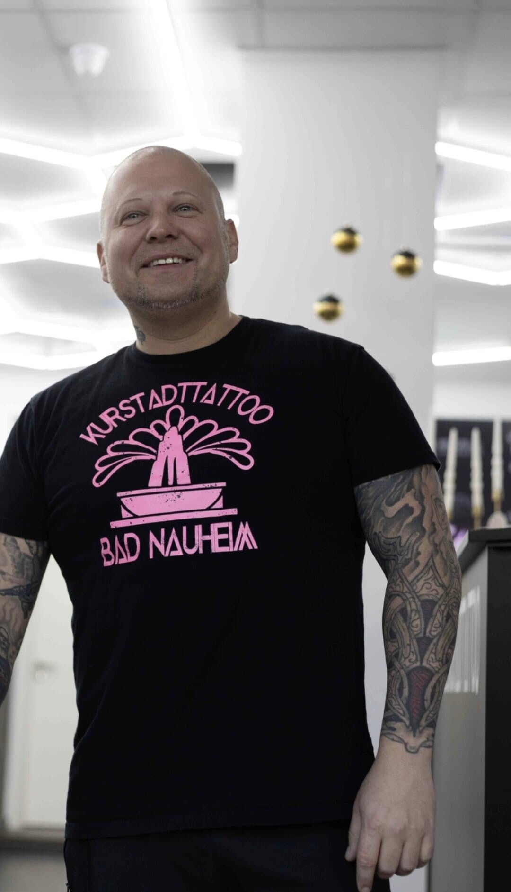

# Quelle: https://www.kurstadttattoo.de/schiedsrichter-und-mediator

- Abgerufen: 2026-11-12 (curl, Original-HTML unter `html/`)
- Title: Tattoo-Pfusch? Mediation & Hilfe | Patrick Wolf
- Meta description: Tattoo verpfuscht oder schlecht gestochen? Patrick Wolf unterstützt bei Streitigkeiten mit Tattoo-Studios durch fachliche Einschätzung und Mediation.
- og:image:
  - patrick-wolf-stehend-studio.jpg
- Header-Bannerbild (Kopfbereich ueber dem Inhalt): (keins)

Rohtext des Bereichs `<main>`, nur Struktur bereinigt, Wortlaut unverändert.

---

# Verpfuschtes Tattoo? Lass es dir nicht gefallen.

Mein Name ist Patrick.
Seit über 22 Jahren bin ich im Tattoo-Geschäft. Ich kenne gute Arbeit – und ich erkenne Pfusch sofort. Genau deshalb trete ich heute als Mediator und Schiedsrichter für diejenigen ein, die mit einem schlechten Tattoo zurückgelassen wurden.

Ein Tattoo ist kein Spielzeug – und Pfusch ist kein Schicksal

Ein Tattoo begleitet dich ein Leben lang.
Wenn es schlecht gestochen, unsauber gearbeitet oder komplett anders umgesetzt wurde als vereinbart, ist das kein „Pech“, sondern ein Problem, für das jemand Verantwortung übernehmen muss.

Du sollst das nicht schlucken.
Und du musst dafür nicht direkt vor Gericht ziehen oder dich einem Anwalt erklären, der von Tattoos keine Ahnung hat.

Du brauchst jemanden,
der die Szene kennt,
der weiß, wie Studios arbeiten,
und der klar benennen kann, wo die Grenze zwischen Fehler und Pfusch überschritten wurde.

Genau das ist meine Aufgabe.

Ich rede Klartext – und setze mich für dich ein

Als Mediator übernehme ich:

eine schonungslose fachliche Einschätzung deines Tattoos,

die direkte außergerichtliche Konfrontation mit dem Tätowierer oder Studio,

die klare Moderation von Vergleichsgesprächen,

und die Durchsetzung einer fairen Lösung – Nachbesserung, Kostenübernahme, Schadenersatz oder Entfernung.

Ohne unnötige Eskalation, aber ohne Wegducken.

Alles, was wir besprechen, bleibt streng vertraulich.
Mein Ziel ist klar: Du bleibst nicht auf einem schlechten Tattoo sitzen – und auch nicht auf den Kosten.

So läuft es ab

Du kommst zu mir für ein persönliches Erstgespräch.
Ich sehe mir dein Tattoo an und sage dir ehrlich und direkt, wie deine Chancen stehen. Kein Drumherumreden, keine falschen Hoffnungen.

Wenn wir zusammenarbeiten, wird das verbindlich geregelt:
Was ich für dich tue, wie ich dich vertrete und welchen Weg wir gehen. Klar. Transparent. Konsequent.

Kontaktiere uns
